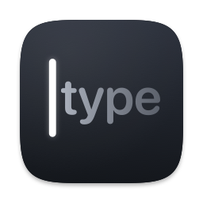
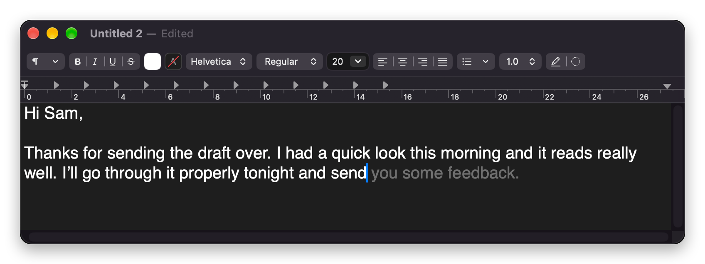

<p align="center">
  
</p>

<h1 align="center">Foretype</h1>

<p align="center">
  <b>Autocomplete for everything you type on your Mac.</b><br>
  Free, open source, and private: the AI runs on your Mac, and what you type stays there.
</p>

<p align="center">
  <a href="https://github.com/DaraSingh1998/foretype/releases/latest"></a>
  
  
</p>

<p align="center">
  
</p>

As you type, Foretype shows the likely rest of your sentence in gray right after the caret,
in Mail, Messages, Slack, Notes, your browser and almost every other app. Press **Tab** to
take the next word, the key above Tab to take all of it, or just keep typing to ignore it.
There is nothing to switch to and nothing to copy and paste: it works where you already
write.

## Install

You need a Mac with Apple silicon (M1 or later) and macOS 14 Sonoma or later. Paste this
into Terminal:

```bash
curl -fsSL https://github.com/DaraSingh1998/foretype/releases/latest/download/install.sh | bash
```

Or download the DMG from [Releases](https://github.com/DaraSingh1998/foretype/releases/latest)
and drag Foretype to Applications. Foretype isn't signed with an Apple Developer ID yet, so
the first time macOS asks: click **Done**, then **System Settings ▸ Privacy & Security ▸
Open Anyway**. You only do this once.

A short setup then asks for the Accessibility permission (so Foretype can read the field
you're typing in and type the words you accept) and downloads a language model sized for
your Mac (1.1 GB on most), once. After that Foretype lives in your menu bar and updates
itself.

## Highlights

- **Works almost everywhere.** Email, chat, notes, documents, web forms, and the prompt of
  AI coding agents such as Claude Code and Codex in your terminal. Code editors, password
  managers, spreadsheets and remote desktops are off by default, and password fields are
  never read.
- **Fast enough to keep up.** A suggestion appears in about 75 ms on an M3 Pro, and typing
  through it, backspacing or taking it word by word needs no new work at all.
- **Saves real typing.** On our 53-document test set the default model saves about 42% of
  keystrokes.
- **Knows what you're replying to.** With the optional Screen Recording permission it reads
  the text around the field, such as the message you're answering, so replies fit the
  conversation.
- **Quotes what's open beside it (opt-in).** With Use Text from Other Apps on, suggestions
  can pick up figures, dates and names from a document, spreadsheet, slides or web page
  open in another window, on any display. Settings ▸ Context ▸ What Foretype Sees shows
  exactly what it has read and what your last suggestion used.
- **Sounds like you (opt-in).** Learn From My Writing picks up the words and phrasing you
  use. Your history is encrypted on your Mac, and one click deletes it.
- **Fills in your details.** Add them once in Settings ▸ About You (or from your Contacts
  card); then "My email is" or a sign-off suggests your own email or name.
- **Small helpers.** `:tada` becomes 🎉, misspelled words get a one-key fix (Hinglish is left alone), and custom
  instructions set the tone (for every app, just one app or just one website).
- **Other words to pick from (experimental).** Turn on Show Alternatives and, when you
  pause, a small numbered card under the caret lists other words Foretype considered;
  Option-1, 2 or 3 takes one.
- **Easy on your battery.** Lighter suggestions on battery, a pause in Low Power Mode, and
  the model unloaded when you stop typing. Pause it for 15 minutes, an hour or until
  tomorrow, everywhere or in one app.
- **Yours to change.** Pick a smaller or larger model, or point it at your own server. The
  interface is in English and Hindi.

## Private by design

- The language model runs on your Mac's GPU. What you type is never sent anywhere.
- Foretype goes online for two things only: downloading a model (checked against a pinned
  checksum) and checking GitHub once a day for updates. If you connect it to a server of
  your own, it talks to that server too.
- Screen text is read with on-device OCR; the image is thrown away at once and the text is
  kept only in memory.
- Text from other apps' windows is read only if you turn it on (off by default; setup only
  mentions it). Foretype reads the windows on your screens, and those you looked at in the
  last 10 minutes, through Accessibility; on Macs with 12 GB or more it can also read a
  window with on-device OCR, discarding the image at once. Macs under 12 GB use
  Accessibility only, and less of the text. It stays in memory, at most 10 minutes after
  you last saw a window, is forgotten whenever Foretype pauses, the screen locks or the Mac
  sleeps, and is never sent to a server, even one you connected (the setting is then
  unavailable). Password managers are never read (you can add any app to that list), nor
  apps where you turned Foretype off, private browsing windows or password fields. **What
  Foretype Sees** (Settings ▸ Context) lists every window held and the passages your last
  suggestion used, from memory only, with Never Read This App and Forget All Now.
- Your writing history (off until you turn it on) and the details you enter in About You
  are stored encrypted with a key in your Keychain, and can be deleted at any time.
- Statistics are numbers only ("Saved 1,234 keystrokes today"), never the text or the app.
- No account, no sign-in, and the source is all here to read.

## Keys

| Key | What it does |
|---|---|
| **Tab** | Take the next word |
| **Key above Tab** (` or §) | Take the whole suggestion |
| **Esc** | Dismiss it and keep that field quiet for 5 seconds (or switch the app off until you change apps, or leave Esc to the app: Settings ▸ Typing) |
| **Option+Tab** | Type a real Tab |
| **Option+1, 2, 3** | With Show Alternatives on and its card up: take that alternative's next word (Tab goes on with it) |
| **Option+0** | With Show Alternatives on: show the alternatives card now, or close it |
| **Ctrl + key above Tab** | Ask for a suggestion where Foretype normally stays quiet |
| **Option-click the menu-bar icon** | Pause or resume everywhere |

## Models

Foretype downloads the right model for your Mac, and the Model menu offers the others:

| Model | Download | Best for | Keystrokes saved | Typical wait |
|---|---:|---|---:|---:|
| Qwen3 0.6B | 0.6 GB | Macs with less than 12 GB of memory | 39.9% | 46 ms |
| Qwen3 1.7B (default) | 1.1 GB | Macs with 12 GB or more | 41.9% | 73 ms |
| Gemma 4 E2B | 3.4 GB | 16 GB or more | 42.8% | 109 ms |
| Qwen3 4B | 2.5 GB | 16 GB or more, best quality | 45.0% | 147 ms |

You can also use your own `llama-server`, any OpenAI-compatible endpoint (Ollama,
LM Studio, a cloud provider), or Apple's on-device model on macOS 26 with Apple
Intelligence. Measured on an M3 Pro; see [Measurements](docs/MEASUREMENTS.md).

## Status

Foretype is young (version 0.1). It is tested end to end in TextEdit, Chrome and Terminal,
but some apps (Microsoft Teams, Mail, Notes, LibreOffice) haven't been checked live yet. It is macOS only for now; the engine is
portable, so Windows and Linux remain possible later. See the
[roadmap](docs/ROADMAP.md) and the [known limitations](docs/REFERENCE.md#known-limitations-mvp).

Bug reports and ideas are welcome in [Issues](https://github.com/DaraSingh1998/foretype/issues).

## For developers

Foretype is a portable Rust core (prompting, per-app rules, in-process llama.cpp with
prefix caching and token healing) behind a small Swift app that reads the focused field
through Accessibility, draws the ghost text and types what you accept.

```bash
brew install rust cmake
scripts/build-mac.sh   # builds build/Foretype.app
```

| Document | What's in it |
|---|---|
| [Reference](docs/REFERENCE.md) | Every feature and setting in detail, per-app behaviour, building, dev tools, known limitations |
| [Architecture](docs/ARCHITECTURE.md) | Components, threads, data flow, the C ABI, prompt format, caching |
| [Development](docs/DEVELOPMENT.md) | Build, test, replay, end-to-end tests, debugging, macOS permission traps |
| [Decisions](docs/DECISIONS.md) | Why things are the way they are |
| [Measurements](docs/MEASUREMENTS.md) | Every benchmark and replay, with how to reproduce it |
| [Roadmap](docs/ROADMAP.md) | What's done, what's next |
| [Releasing](RELEASING.md) · [Changelog](CHANGELOG.md) | Shipping a version, and what changed |

## Credits and licence

Inspired by [Cotypist](https://cotypist.app). Built on [llama.cpp](https://github.com/ggml-org/llama.cpp)
and [Sparkle](https://sparkle-project.org), with Qwen3 and Gemma models.

Foretype is MIT OR Apache-2.0; the per-app rules in `compat/apps.json` are CC0. Models are
downloaded separately under their own licences (Apache-2.0 for the catalog). Third-party
code and data are listed in [THIRD_PARTY_NOTICES.md](THIRD_PARTY_NOTICES.md).
